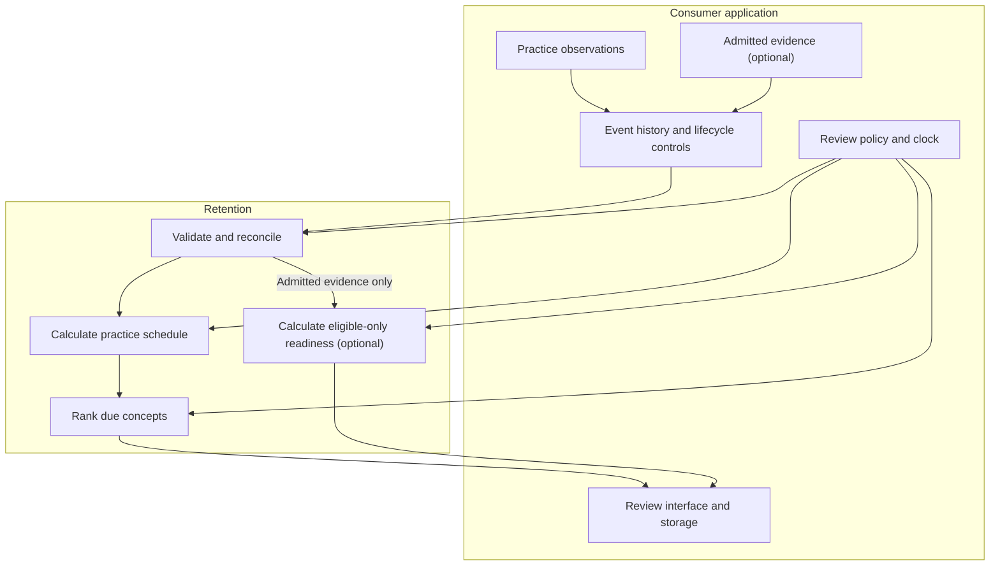
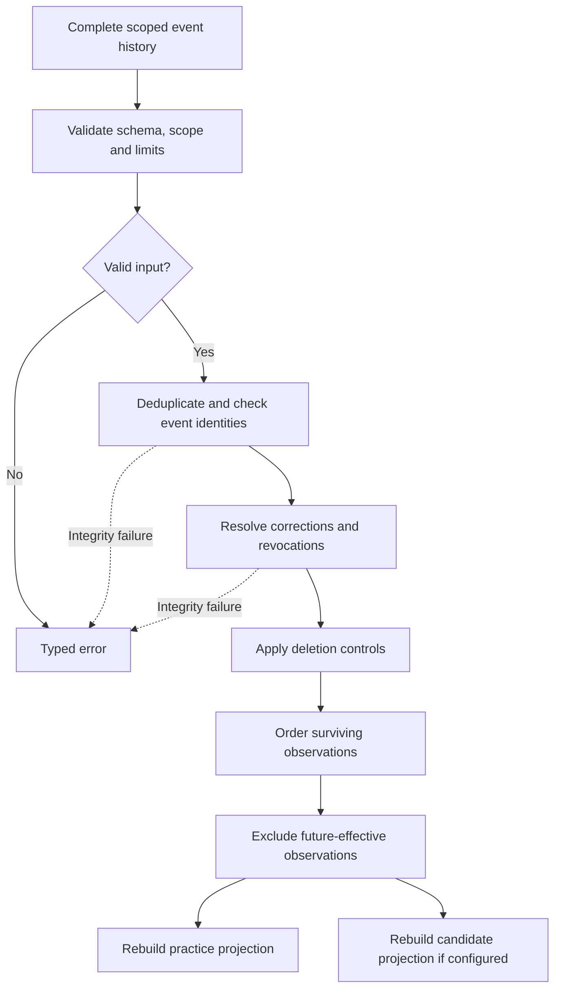
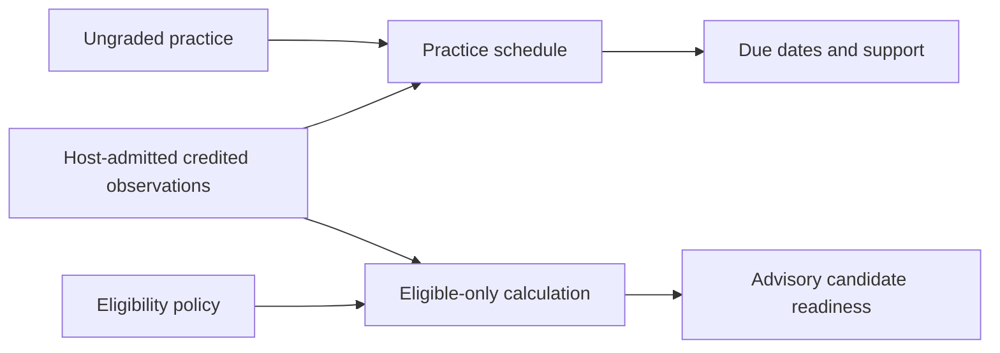

# Retention

**Deterministic review scheduling for learning and long-term retention.**

Retention determines what to review, when to review it, and when further practice may be needed. It uses previous learning observations and configurable review policies to calculate spaced retrieval schedules, prioritize due material and recommend targeted practice.

Use it to schedule vocabulary reviews, revisit mathematical concepts, reinforce programming skills or build review systems into learning applications. Retention works without a server, database, model provider or account. Applications retain ownership of their learning records and assessment decisions.

> Status: in development. The design below describes the planned first release, `@0xbuff/retention@0.0.1`. Installation and usage instructions will accompany the implemented package.

## How it works

Suppose a learner successfully recalls a concept on Monday. A review policy can schedule the next attempt for Tuesday, then increase the interval after each successful review. If the learner struggles, the policy can schedule an earlier retry or recommend additional practice.

With an example interval policy of 1, 3, 7, 16 and 35 elapsed days, a learner who passes each review when due would follow this schedule:

| Retrieval succeeds on | Next review |
| --- | --- |
| Day 0 | Day 1 |
| Day 1 | Day 4 |
| Day 4 | Day 11 |
| Day 11 | Day 27 |
| Day 27 | Day 62 |
| Day 62 | After the configured maintenance interval |

Practicing early does not advance an existing interval. A missed review follows the configured retry, restart and support rules. Applications choose their own intervals and maintenance policy; the example is not a universal learning standard.

## Capabilities

- Configurable spaced retrieval, retry intervals and maintenance reviews.
- Support recommendations and delayed retrieval probes.
- Due-review ranking across concepts, with optional priority weights and relationships.
- Elapsed-time or local-calendar scheduling using explicit timezone rules.
- Replay of duplicated, reordered, corrected, revoked or deleted observations.
- Optional advisory readiness based on independently admitted evidence.

Calculations are reproducible for the same validated history, policy, algorithm revision and clock. Retention does not inspect answers, authenticate learners, issue grades, certify mastery or deliver notifications.

## Architecture

The application records practice, supplies a policy and calls Retention with an explicit clock. Retention reconciles the history and calculates review projections. The application decides how to present and store the results.

### Replay

Review histories can arrive out of order. An application may also need to correct a previous result or remove a learner's data. Retention uses stable event identities and a durable sequence to reconstruct the active observations before calculating a schedule.

Identical duplicate events have no effect. Conflicting identities and invalid correction chains produce typed failures. A corrected decision replaces the original observation instead of counting as another success. Deletion controls suppress affected history during replay; the application remains responsible for physical erasure and preventing obsolete histories from returning.

Full replay is the reference calculation. The initial advance operation verifies the previous projection identity and complete event prefix before rebuilding. Policy changes require explicit replay.

### Readiness and evidence

Practice observations can influence due dates and support recommendations. Applications that track independently assessed work can also supply admitted evidence under a separate eligibility policy.

An eligibility policy might require three fresh successes in at least two sessions over a minimum span of 24 hours. Only qualifying admitted observations start and extend that streak. A local study tool can omit this policy entirely.

Retention cannot establish whether evidence is authentic. The application admits evidence and makes any official assessment or credit decision independently.

## Planned API

| Operation | Purpose |
| --- | --- |
| `validatePolicy` | Validate and normalize a versioned policy. |
| `validateEvents` | Validate event shape and scope. |
| `rebuildReview` | Reconstruct review projections from complete history. |
| `advanceReview` | Verify the prior identity and event prefix, then rebuild with new events. |
| `evaluateReadiness` | Calculate advisory readiness from reconciled eligible evidence. |
| `scheduleDue` | Select and rank due concepts. |
| `explainReview` | Return structured reasons for a recommendation. |

The [review scheduling specification](https://github.com/0xbuffdev/context/blob/main/repos/retention/specs/0001-review-scheduling.md) defines the event schemas, policy fields, transition rules, resource limits and error behavior.

## Development

The source is planned as a single TypeScript package with a platform-neutral ESM entry point and type declarations. The development toolchain uses pnpm, strict TypeScript, Vitest and tsdown. The core requires no runtime services.

See the [source architecture](https://github.com/0xbuffdev/context/blob/main/repos/retention/architecture.md) for the repository layout, module dependencies, build configuration and testing conventions. The [implementation tickets](https://github.com/0xbuffdev/context/blob/main/repos/retention/tickets.md) track progress toward the first release, including independent Node.js and browser consumer checks.

To contribute before the first release, review the [architecture decision](https://github.com/0xbuffdev/context/blob/main/repos/retention/adr/0001-deterministic-scheduling.md) and [implementation plan](https://github.com/0xbuffdev/context/tree/main/repos/retention), then use the repository's [issue tracker](https://github.com/0xbuffdev/retention/issues) for questions or proposed changes.

## License

MIT is the proposed license, pending approval and inclusion of the license file.
