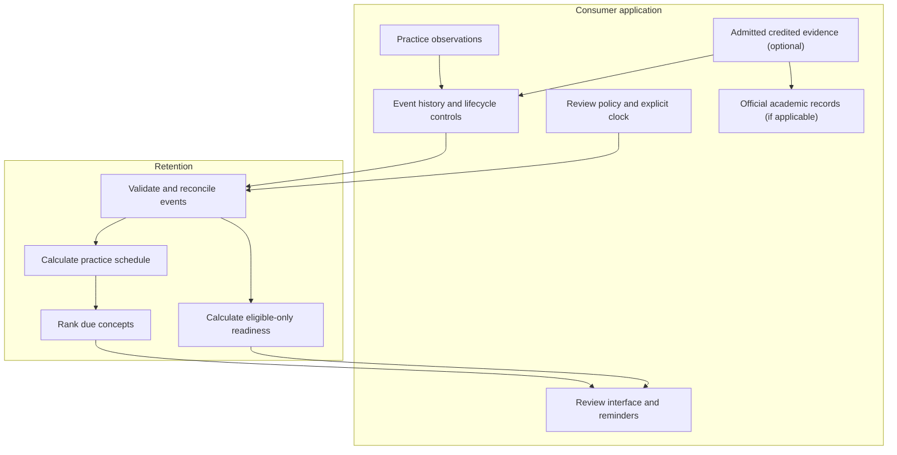
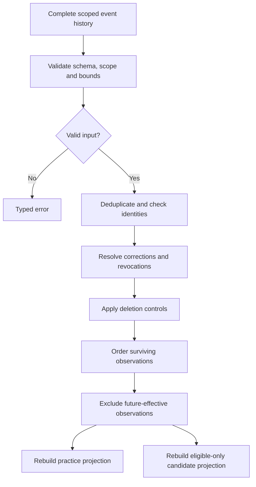
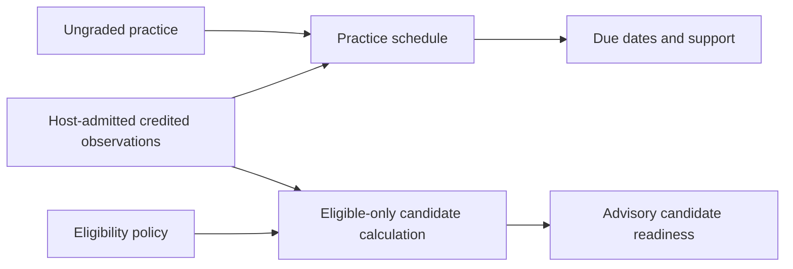
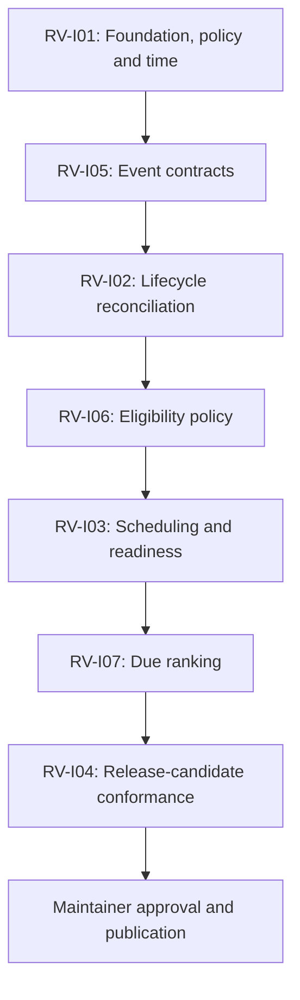

# Retention

Retention is a TypeScript library for scheduling reviews of material someone has already studied. It takes a review policy, a history of practice observations and the current time, then calculates what is due and when to review it again.

A flashcard application can use it to schedule vocabulary practice. A programming course can use it to recommend another exercise on pointers after a successful retrieval. The application supplies the observations and stores the results.

Retention is designed to run in an application without a separate server, database, model provider or account. Its calculations are deterministic: the same validated history, policy, algorithm revision and clock produce the same result.

> Development status: pre-implementation. This README describes the planned first release, `@0xbuff/retention@0.0.1`. The package is not yet available to install.

## What Retention calculates

- Review intervals and due dates based on a configurable policy.
- Retry dates and support recommendations when practice is unsuccessful.
- Delayed retrieval probes and continued reviews after the final interval.
- An ordered queue of due concepts, with optional weights and concept relationships.
- Advisory candidate readiness from evidence an application has independently admitted, when an eligibility policy is configured.

The scheduler does not inspect answers, authenticate learners, award grades or certify mastery. It does not send reminders. Applications decide how and when to present a recommendation and remain responsible for their own records.

## How review scheduling works

A policy specifies the intervals between reviews, the retry and maintenance intervals, the support threshold and the response to a missed long probe.

For example, consider a policy with intervals of 1, 3, 7, 16 and 35 days. If a learner passes each review exactly when it is due, an initial successful practice on day 0 produces the following schedule:

| Successful retrieval | Next interval | Next review |
| --- | ---: | ---: |
| Day 0 | 1 day | Day 1 |
| Day 1 | 3 days | Day 4 |
| Day 4 | 7 days | Day 11 |
| Day 11 | 16 days | Day 27 |
| Day 27 | 35 days | Day 62 |
| Day 62 | Maintenance interval | Policy-dependent |

A successful attempt before the due time does not advance an existing interval. An unsuccessful attempt can restart progression or trigger support according to the policy. The example intervals are configurable; they are not a universal learning standard.

Retention supports elapsed days of exactly 86,400,000 milliseconds and a local-calendar profile with caller-supplied timezone transition rules. The latter lets an application preserve local review times across daylight-saving changes without depending on the timezone database installed on a particular machine.

## Architecture

### Application boundary

The caller supplies a complete, scoped history with stable event IDs and a durable sequence. Retention validates the input, reconstructs the active observations and returns projections for the caller to store or display. The engine has no path for writing to an academic ledger.

### Event replay

Applications may receive an event more than once or discover that an earlier observation was incorrect. Corrections, revocations and deletion controls therefore form part of the replay contract.

An identical duplicate has no effect. Conflicting identities and invalid correction chains produce errors. A correction replaces an earlier credited decision; it does not create an additional retrieval success. A deletion suppresses the affected history during replay, including late deliveries.

Full replay is the reference calculation. The planned advance operation checks the previous projection identity and complete event prefix before rebuilding with new events. It does not trust an opaque snapshot or silently apply a different policy. Physical data erasure and protection against obsolete history generations remain the application's responsibility.

### Practice and candidate readiness

An application that only needs spaced reviews can omit the eligibility policy. When configured, the candidate calculation considers qualifying successes, distinct sessions, elapsed time between qualifying events and the policy's freshness, difficulty and hint constraints. Practice observations do not contribute to the eligible-only streak.

For example, a policy can require three fresh successes across two sessions with at least 24 hours between the first and last qualifying observations. A successful practice attempt from the previous week cannot start that clock unless it qualifies as admitted evidence. The application still decides whether any formal credit is warranted.

## Planned API

The initial package will expose a small set of typed operations through its root ESM entry point. The specification governs their behavior; exact usage examples will accompany the implementation.

| Operation | Purpose |
| --- | --- |
| `validatePolicy` | Validate and normalize a versioned review policy. |
| `validateEvents` | Validate event shape and scope before lifecycle reconciliation. |
| `rebuildReview` | Reconstruct review and optional candidate projections from complete history. |
| `advanceReview` | Rebuild after verifying the previous identity and complete event prefix. |
| `evaluateReadiness` | Calculate advisory readiness without bypassing event reconciliation. |
| `scheduleDue` | Select and rank due concepts using compatible projections. |
| `explainReview` | Return structured reasons for a review recommendation. |

Expected input failures return typed results. The engine accepts bounded data, rejects unsupported schema versions and keeps raw learner answers and transcripts out of its diagnostics.

## Source layout

The repository will grow through the implementation tickets. The planned modules have the following responsibilities:

| Directory | Responsibility |
| --- | --- |
| `src/contracts/` | Event, policy, projection and result types. |
| `src/validation/` | Runtime validation and resource limits. |
| `src/time/` | Elapsed and calendar arithmetic. |
| `src/events/` | Identity, ordering and lifecycle controls. |
| `src/replay/` | Reconciliation and projection orchestration. |
| `src/scheduling/` | Interval progression, support and delayed probes. |
| `src/readiness/` | Qualification, streaks and candidate readiness. |
| `src/priority/` | Due selection and ranking. |
| `src/explanation/` | Structured reason codes. |
| `tests/` | Unit, integration, conformance, property and adversarial tests. |
| `examples/` | Independent practice and admitted-evidence consumers. |

The source will use strict TypeScript, pnpm, Vitest and tsdown. The public package will target a platform-neutral ESM build with TypeScript declarations. Supported runtime versions and installation instructions will be documented when verified.

## Implementation and release

The first release requires the seven implementation tickets in this order:

RV-I04 covers the complete library, including the applicable acceptance scenarios, security and resource limits, independent Node.js and browser consumers, and verification of the exact npm archive. Publication requires separate approval. Integrating Retention into an existing application is separate work.

The project design and implementation plan live in the [engineering context repository](https://github.com/0xbuffdev/context/tree/main/repos/retention):

- [Architecture decision](https://github.com/0xbuffdev/context/blob/main/repos/retention/adr/0001-deterministic-scheduling.md)
- [Review scheduling specification](https://github.com/0xbuffdev/context/blob/main/repos/retention/specs/0001-review-scheduling.md)
- [Source architecture and tooling](https://github.com/0xbuffdev/context/blob/main/repos/retention/architecture.md)
- [Implementation tickets](https://github.com/0xbuffdev/context/blob/main/repos/retention/tickets.md)

## License

MIT is the proposed license. Reuse rights depend on maintainer approval and the license file included with the source.
